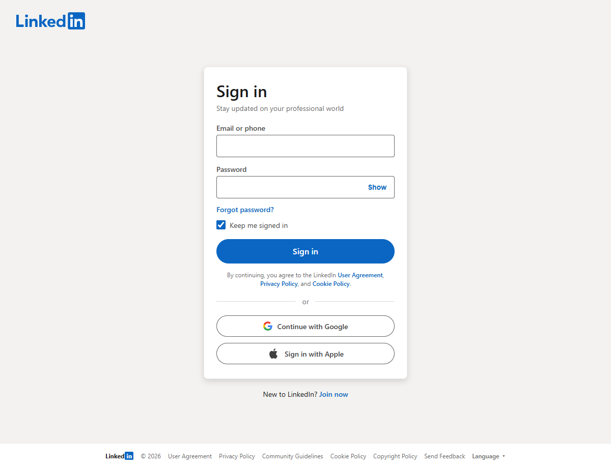
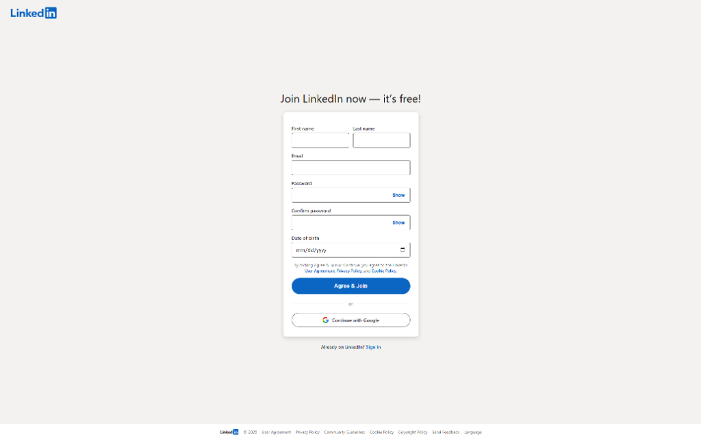

# LinkedIn Login

is a simple school project that simulates the login and registration system of a professional platform, specifically LinkedIn. This project focuses on user authentication, form validation, and basic functionality for a polished front-end experience.

## FEATURES

* **USER REGISTRATION**: Create a new account with first name, last name, email, password, confirm password, and date of birth.
* **USER LOGIN**: Authenticate and access the platform using email or phone and password.
* **FORM VALIDATION**: Real-time password matching validation and required input checks.
* **RESPONSIVE DESIGN**: Clean and simple interface for a user-friendly experience styled to match LinkedIn.

## TECHNOLOGIES USED

* **FRONT-END**: HTML, CSS, JavaScript

## SCREENSHOTS

### Login



### Register



## FOLDER STRUCTURE

```
LinkedIn_Login/
│
├── index.html          # Main login HTML file
├── signup.html         # Registration HTML file
├── css/
│   └── style.css       # Stylesheets
├── pictures/
│   ├── favicon.ico     # Favicon
│   ├── login.png       # Screenshot of login page
│   └── register.png    # Screenshot of register page
└── README.md           # Project documentation
```

## USAGE

1. Open `index.html` in a browser to explore the interface.
2. Click "Join now" to navigate to the registration page (`signup.html`).
3. Fill in the fields and test real-time password validation.
4. Enjoy the clean LinkedIn simulation.

OR

Open it from GitHub Pages: [LinkedIn_Login](https://alentrost.github.io/LinkedIn_Login/)

## SIMULATION CREDENTIALS

* **Email:** `example@gmail.com`
* **Password:** `Password123`

## AUTHOR

Alen Trošt

## INSTALLATION

1. Clone the repository:
```bash
git clone https://github.com/alentrost/LinkedIn_Login.git
```
